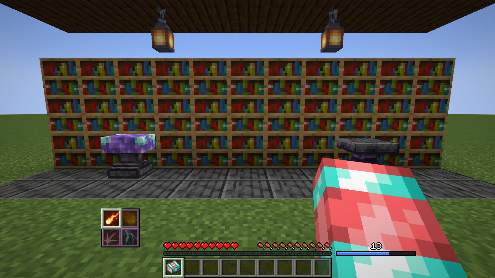
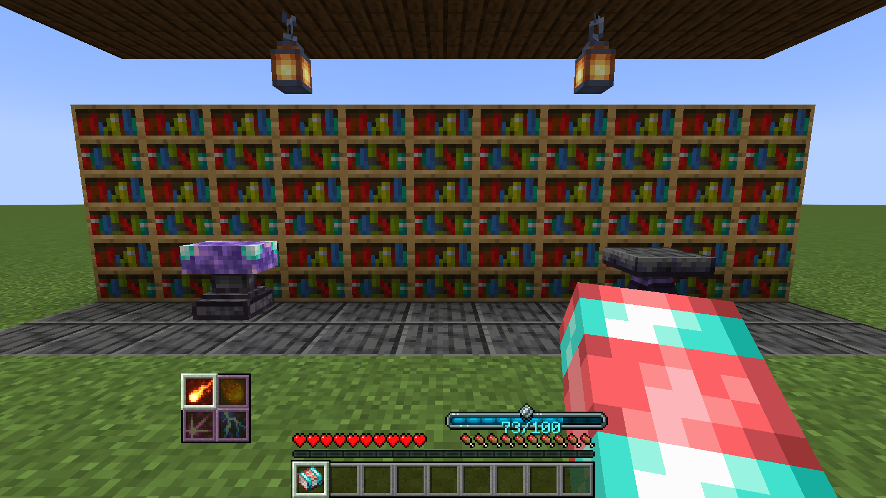
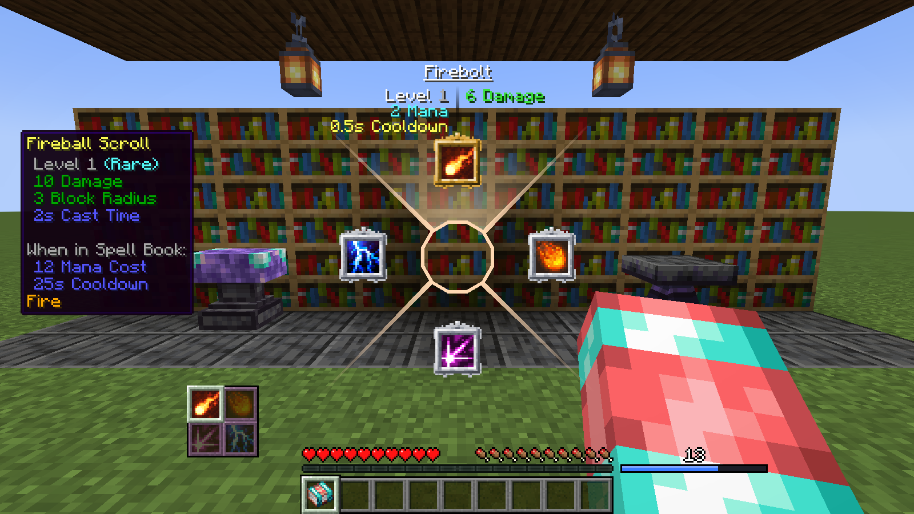
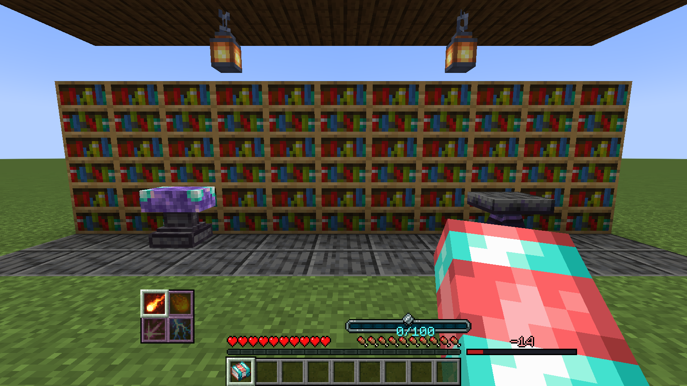
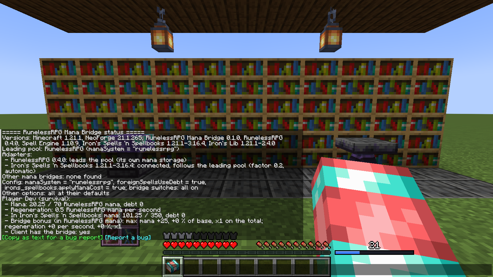
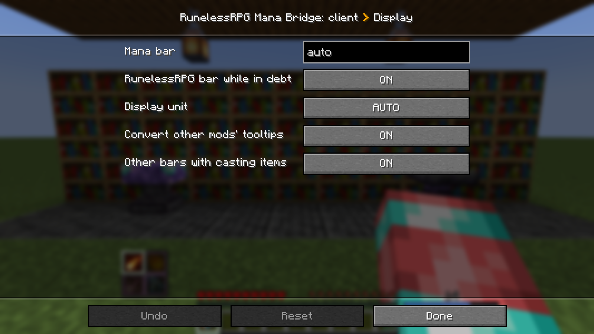

<p align="center">
  
</p>

<h1 align="center">RunelessRPG Mana Bridge</h1>

<p align="center">
  
  
  
  
</p>

🔮 **One mana pool for all your magic.** RunelessRPG Mana Bridge is a NeoForge mod for Minecraft 1.21.1 (Java 21) that connects [RunelessRPG](https://www.curseforge.com/minecraft/mc-mods/runelessrpg) (mana for Spell Engine spells) and [Iron's Spells 'n Spellbooks](https://www.curseforge.com/minecraft/mc-mods/irons-spells-n-spellbooks) into one shared mana pool. A Fireball from the RPG Series and a Fireball from Iron's take their mana from the same pool. The pack chooses which mod leads the pool, and every player chooses which mana bar to see.

> **Beta.** This is the first version. I tested it thoroughly with automated tests (both modes, debt, gear, displays, other bridges, clients with and without the mod), but I do not play with Iron's Spells 'n Spellbooks myself, so your reports are the real test. Please report bugs on the [issue tracker](https://github.com/Drehverschluss/RunelessRPG-Mana-Bridge/issues) and add the output of `/runelessrpg_bridge status`.
>
> **Client & Server.** Install it on the server and on every client. A client without it can still join; the pool and the costs are right, only the bar choice and the converted numbers are missing.
>
> **Built for pack developers.** Which mod leads, the conversion factor, which bonuses cross over, the debt rules and the leech rules are config options and tags. The full documentation is in the [wiki](https://github.com/Drehverschluss/RunelessRPG-Mana-Bridge/wiki).

At the moment only Iron's Spells 'n Spellbooks is connected. Ars Nouveau is not connected; with Ars installed the bridge does nothing for it.

## Screenshots

| | |
|---|---|
|  |  |
|  |  |
|  |  |
|  | |

## How it works

RunelessRPG 0.4.0 has an API for other mana systems: a replaceable mana storage, a debt account and helpers to pay for spells of other mods. The bridge sits on top of it. Inside, everything is counted in RunelessRPG mana; every other mod has a **factor** (1 Iron's mana = 0.2 RunelessRPG mana by default, RunelessRPG's base max mana of 20 divided by Iron's base max mana of 100).

- **The leading mod** (`manaSystem`) holds the number. It keeps its own base mana, regeneration and respawn rule. By default RunelessRPG leads; with `manaSystem = "irons_spellbooks"` Iron's own mana becomes the pool.
- **The other mod follows**: a small set of mixins (only `@Inject`, `@WrapOperation` and `@ModifyReturnValue`) makes Iron's read and write the shared pool in its own units, turns off its own regeneration and respawn rule and lets Iron's spells pay through RunelessRPG with the same cost and debt rules as Spell Engine spells.
- **Bonuses cross over**: max mana and regeneration bonuses of the following mod's gear are read every tick, converted and added to the leading mod as modifiers of the same operation.
- **A self test** checks at startup that every mixin found its target. If Iron's changes in an update, only the Iron's adapter turns off with one warning, and Iron's works as without the bridge.

Changing the mode only changes the regeneration: the same gear and the same spells give the same share of the pool in both modes.

## Installation

1. Install NeoForge `21.1` for Minecraft `1.21.1`.
2. Install [RunelessRPG](https://www.curseforge.com/minecraft/mc-mods/runelessrpg) `0.4.0` or newer with [Spell Engine](https://www.curseforge.com/minecraft/mc-mods/spell-engine).
3. Install [Iron's Spells 'n Spellbooks](https://www.curseforge.com/minecraft/mc-mods/irons-spells-n-spellbooks) with its own dependencies.
4. Put `runelessrpg_bridge-0.1.0.jar` into the `mods` folder of the **server and of every client**.

| Mod | Tested version | Needed |
|---|---|---|
| RunelessRPG | `0.4.0` | **required** (`0.4.0` or newer) |
| Spell Engine, Spell Power | `1.10.9`, `1.6.0` | required by RunelessRPG |
| Iron's Spells 'n Spellbooks | `1.21.1-3.16.4` | optional, but without it the bridge does nothing (`1.21.1-3.16.4` or newer) |
| Iron's Lib | `1.21.1-2.4.0` | required by Iron's Spells 'n Spellbooks |
| Ars Nouveau | `5.13.5` | not connected yet, the bridge does nothing for it |

Without Iron's the bridge writes one line to the log and does nothing else.

## What it does

### One pool for both mods
Iron's spells, Iron's Mana potion, Gluttony and the `/mana` command use the shared pool. With the default factor an Iron's Fireball (60 Iron's mana) costs 12 RunelessRPG mana, and while Iron's leads an RPG Series Fireball (4 RunelessRPG mana) costs 20 Iron's mana. Iron's mobs keep their own mana. More: [Wiki → How it works](https://github.com/Drehverschluss/RunelessRPG-Mana-Bridge/wiki/How-It-Works).

### Two modes
| `manaSystem` | Base max mana | Regeneration | After a respawn |
|---|---|---|---|
| `"runelessrpg"` (default) | RunelessRPG: 20 | RunelessRPG: 0.5 per second plus bonuses | full (RunelessRPG) |
| `"irons_spellbooks"` | Iron's: 100 | Iron's: 2 % of max mana per second plus bonuses | Iron's `manaSpawnPercent` (default 0 = empty) |

Packs with many Iron's addons, or with mods that read Iron's mana themselves, should let Iron's lead. More: [Wiki → Modes](https://github.com/Drehverschluss/RunelessRPG-Mana-Bridge/wiki/Modes).

### Gear of both mods counts
Iron's robes, rings, spell books in the spellbook slot and mana upgrade orbs raise the shared pool while RunelessRPG leads (a robe with +125 Iron's max mana gives +25). While Iron's leads, RunelessRPG's enchantments, affixes and gear raise Iron's mana (+25 RunelessRPG max mana gives +125). Flat values are converted, percent values stay percent.

### Costs and debt
Iron's spell costs follow `runelessrpg:mana_cost` (with its lower limit and Spell Infinity), and Iron's spells use the same debt rules as Spell Engine spells (RunelessRPG's DEBT modes, Borrowed Power), in both modes. Iron's bar cannot show debt, so RunelessRPG's bar appears with the minus while you are in debt. More: [Wiki → Iron's Spells](https://github.com/Drehverschluss/RunelessRPG-Mana-Bridge/wiki/Irons-Spells).

### Mana bar and units
Every player picks the bar (`manaDisplay`: the leading mod's, RunelessRPG's, Iron's or both) and the unit of all numbers (`displayUnit`). Iron's spell tooltips, the spell wheel, the Inscription Table and max mana values on Iron's gear are converted into that unit, RunelessRPG's own numbers too. Iron's bar in its "Contextual" mode also shows while you hold a Spell Engine spell weapon. More: [Wiki → Display](https://github.com/Drehverschluss/RunelessRPG-Mana-Bridge/wiki/Display).

### Spell Mana Leech for Iron's spells
`runelessrpg:spell_mana_leech` also works on direct hits of Iron's spells (instant, channeled, projectile and cone spells), with all of RunelessRPG's rules. Zones, summons and damage over time do not count. More: [Wiki → Spell Mana Leech](https://github.com/Drehverschluss/RunelessRPG-Mana-Bridge/wiki/Spell-Mana-Leech).

### Other mana bridges
Ars 'n Spells, Ars Mana Bridge, Mana Transform and Unified Mana are detected. While one of them connects Iron's mana itself, the Iron's adapter turns off with a warning in the log and a chat message for operators, so two bridges never pull at the same pool. More: [Wiki → Other mana bridges](https://github.com/Drehverschluss/RunelessRPG-Mana-Bridge/wiki/Other-Mana-Bridges).

### Status command
`/runelessrpg_bridge status` shows versions, the leading pool, the state of every adapter, other bridges, the config and your own mana. A click at the end copies everything as English text for a bug report. Every player can use it for themselves; operators and the console can add a player name. More: [Wiki → Commands and bug reports](https://github.com/Drehverschluss/RunelessRPG-Mana-Bridge/wiki/Commands-and-Bug-Reports).

## Configuration

`config/runelessrpg_bridge-server.toml` (server, sent to the clients where needed):

| Option | Default | Effect |
|---|---|---|
| `general.manaSystem` | `"runelessrpg"` | Which mod leads the pool: `"runelessrpg"` or `"irons_spellbooks"` |
| `general.foreignSpellsUseDebt` | `true` | Iron's spells may go into debt like Spell Engine spells |
| `irons_spellbooks.manaFactor` | `-1.0` | 1 Iron's mana = this much RunelessRPG mana; −1 = automatic (0.2) |
| `irons_spellbooks.applyManaCost` | `true` | `runelessrpg:mana_cost` applies to Iron's spells |
| `irons_spellbooks.bridgeMaxMana`, `bridgeManaRegen`, `bridgePercentBonuses` | `true` | Which bonuses of Iron's gear count while RunelessRPG leads |
| `runelessrpg.bridgeMaxMana`, `bridgeManaRegen`, `bridgePercentBonuses` | `true` | Which bonuses of RunelessRPG's gear count while Iron's leads |

`config/runelessrpg_bridge-client.toml` (every player): `manaDisplay` (`"auto"`), `displayUnit` (`AUTO`), `showRunelessBarOnDebt`, `convertForeignTooltips` and `showForeignBarWithSpellWeapons` (all `true`). Every option works at runtime. All options with their effect: [Wiki → Configuration](https://github.com/Drehverschluss/RunelessRPG-Mana-Bridge/wiki/Configuration).

## Data-driven customization

Which hits of Iron's spells count for Spell Mana Leech can be changed with two entity tags:

| Tag | Default entries | Effect |
|---|---|---|
| `runelessrpg_bridge:spell_leech/direct` | lightning bolt, evoker fangs, firework rocket, Devour jaw, Sunbeam, Ice Spike, Poison Splash | Hits by these entities always count |
| `runelessrpg_bridge:spell_leech/excluded` | Echoing Strikes (sword and arrow), Ball Lightning | Hits by these entities never count (wins over `direct`) |

Add entries with a datapack (`data/runelessrpg_bridge/tags/entity_type/spell_leech/direct.json`). RunelessRPG's `#runelessrpg:no_mana_leech` still applies to the targets. Example: [Wiki → Spell Mana Leech](https://github.com/Drehverschluss/RunelessRPG-Mana-Bridge/wiki/Spell-Mana-Leech).

## Mod compatibility

| Mod | What happens |
|---|---|
| Iron's Spells 'n Spellbooks | connected (follows or leads) |
| Iron's addons | Their spells and their mana access through Iron's `MagicData` use the shared pool; not tested one by one, see [Wiki → Modes](https://github.com/Drehverschluss/RunelessRPG-Mana-Bridge/wiki/Modes) |
| Ars Nouveau | not connected yet, keeps its own mana |
| Ars 'n Spells, Ars Mana Bridge, Mana Transform, Unified Mana | detected; the Iron's adapter turns off while they connect Iron's mana |
| Miki's Fantasy HUD | RunelessRPG's bar docks there as before; where Iron's bar sits is set in Iron's own client config |
| Gearscope | shows Iron's max mana in the display unit |

## Project layout

| Package | Content |
|---|---|
| `com.drehverschluss.runelessrpg_bridge` | `ManaBridge` (common entry point) and `ManaBridgeClient` (client entry point) |
| `api` | `ManaAdapter` (one adapter per mana mod, experimental), `AdapterStatus`, `BridgeBonus`, `ConflictCheck` |
| `core` | Leading pool, the switch in other mods' units (`Pool`), bonus bridge, configs, self test, detection of other bridges, status command; no class of another mod |
| `core.network`, `core.client` | Optional settings payload to the clients; bar choice and display unit |
| `adapter.runelessrpg` | RunelessRPG as an adapter (its storage, its bonuses) |
| `adapter.irons_spellbooks` | Iron's adapter: description, hooks, storage while Iron's leads, cost listener, leech rule, mixins (own mixin config, only loaded with Iron's) |

## Development

Requires Java 21. Every mod is compiled against from a Maven (RunelessRPG from CurseMaven, Spell Engine, Spell Power, Iron's, Iron's Lib and Ars Nouveau from the Modrinth Maven), so no local jars are needed to build.

```
./gradlew build        # jar in build/libs
./gradlew runClient    # dev client (game directory run/)
./gradlew runServer    # dev dedicated server (accept the EULA on first start)
```

### Testing

The dev runs load test mods from `libs/test/` (git-ignored) in groups. The Gradle property `test_mods` picks them: `none` (only RunelessRPG with Spell Engine and the RPG Series), `irons`, `ars` or `irons,ars` (default), for example `./gradlew runServer -Ptest_mods=none`. Every change is tested in all four groups.

For every version I run an automated test: a dedicated server plays a script tick by tick (casting spells of both mods, changing configs at runtime, switching the mode, debt, gear, relog, respawn, other bridges, two clients, clients and servers without the bridge), and the client takes pictures and reads tooltips on request. The test code is removed before the release.

## License and credits

MIT, see [LICENSE](LICENSE). Credits and licenses of everything the bridge uses or refers to are in [CREDITS.md](CREDITS.md).

- RunelessRPG Mana Bridge is not made by or affiliated with the authors of Iron's Spells 'n Spellbooks or Spell Engine.
- 📖 [Wiki](https://github.com/Drehverschluss/RunelessRPG-Mana-Bridge/wiki) · 🐞 [Issues](https://github.com/Drehverschluss/RunelessRPG-Mana-Bridge/issues) · CurseForge: coming soon
