<p align="center">
  
</p>

<h1 align="center">RunelessRPG Mana Bridge</h1>

<p align="center">
  
  
  
  
</p>

🔮 **One mana pool for all your magic.** RunelessRPG Mana Bridge is a NeoForge mod for Minecraft 1.21.1 (Java 21) that connects [RunelessRPG](https://www.curseforge.com/minecraft/mc-mods/runelessrpg) (mana for Spell Engine spells), [Iron's Spells 'n Spellbooks](https://www.curseforge.com/minecraft/mc-mods/irons-spells-n-spellbooks) and [Ars Nouveau](https://www.curseforge.com/minecraft/mc-mods/ars-nouveau) into one shared mana pool. A Fireball from the RPG Series, a Fireball from Iron's and an Ars spell take their mana from the same pool. The pack chooses which mod leads the pool, and every player chooses which mana bar to see. Since version 0.2.0 the mana system can be chosen in game, and RunelessRPG's Overcharge works on Iron's and Ars spells too.

> **Beta.** Version 0.2.0 is still a beta. I tested it thoroughly with automated tests (all three modes, the choice of the mana system, costs, overcharge for every form of Iron's and Ars spells, debt, gear and progress, familiars, displays, other bridges, clients with and without the mod, clients and servers with 0.1.0), but I do not play with Iron's Spells 'n Spellbooks or Ars Nouveau myself, so your reports are the real test. Please report bugs on the [issue tracker](https://github.com/Drehverschluss/RunelessRPG-Mana-Bridge/issues) and add the output of `/runelessrpg_bridge status`.
>
> **Client & Server.** Install it on the server and on every client. A client without it can still join; the pool and the costs are right, only the bar choice and the converted numbers are missing.
>
> **Built for pack developers.** Which mod leads, the conversion factors, which bonuses cross over, the debt rules and the leech rules are config options and tags. The full documentation is in the [wiki](https://github.com/Drehverschluss/RunelessRPG-Mana-Bridge/wiki).

Iron's and Ars are both optional: the bridge connects whichever of the two is installed. Addons of both mods are not tested one by one, see [Mod compatibility](#mod-compatibility).

## Screenshots

| | |
|---|---|
|  |  |
| 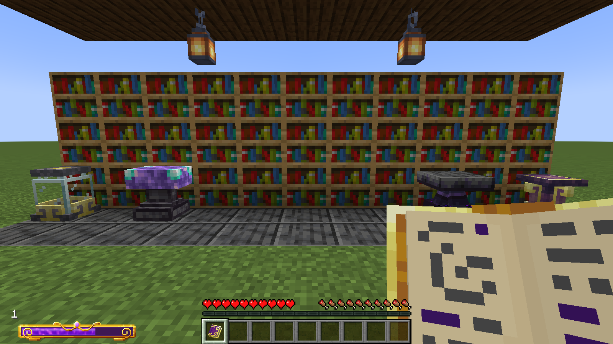 | 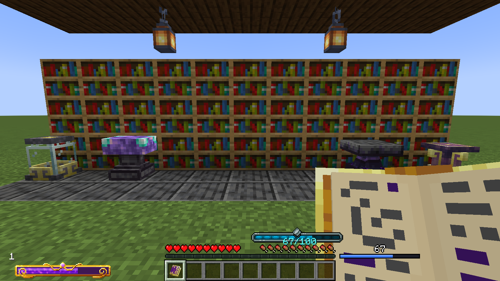 |
| 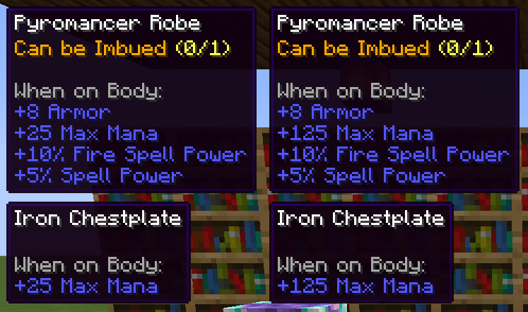 | 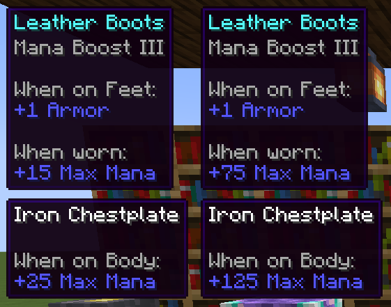 |
|  | 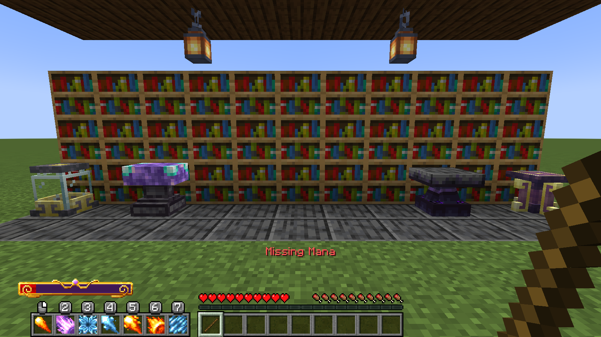 |
|  | 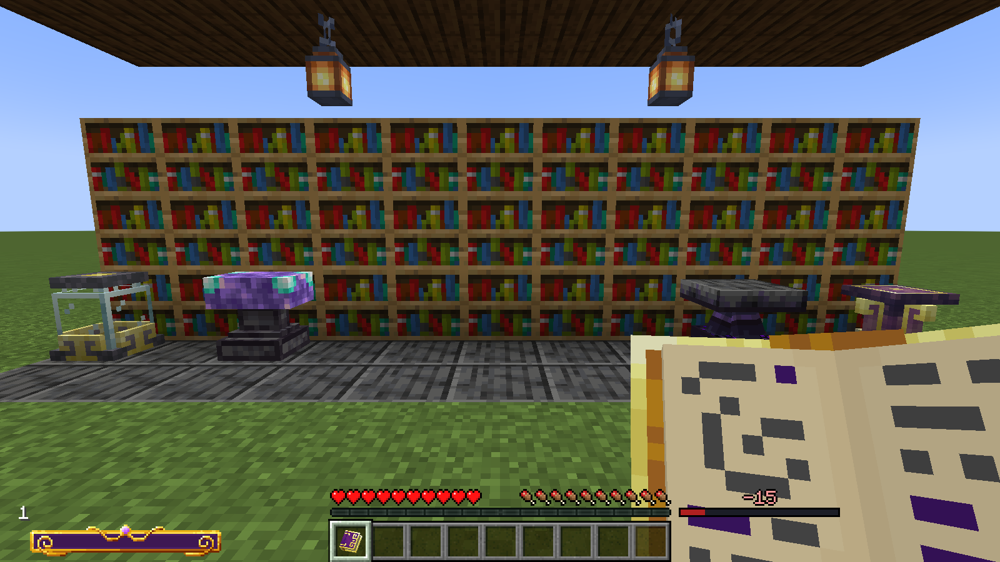 |
| 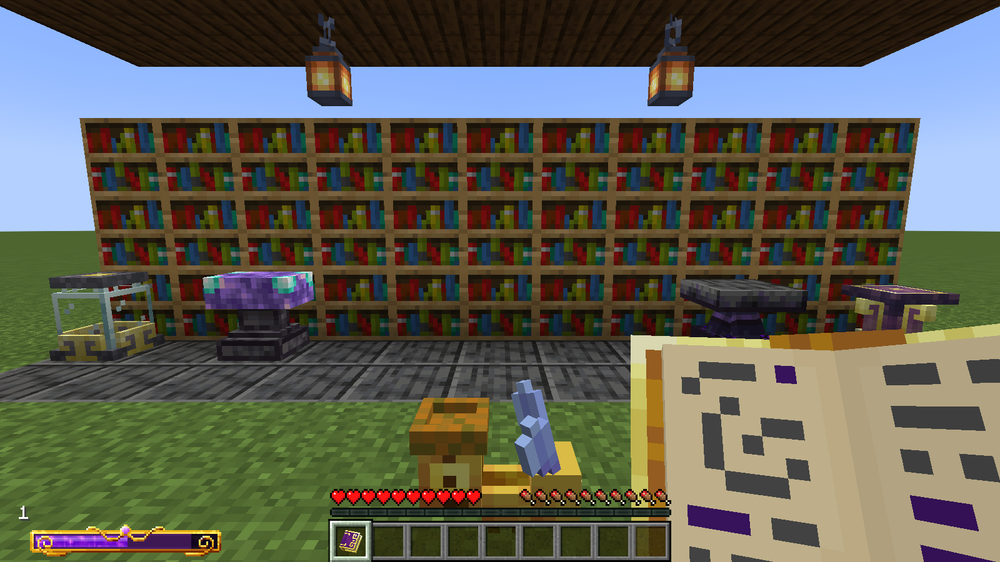 | 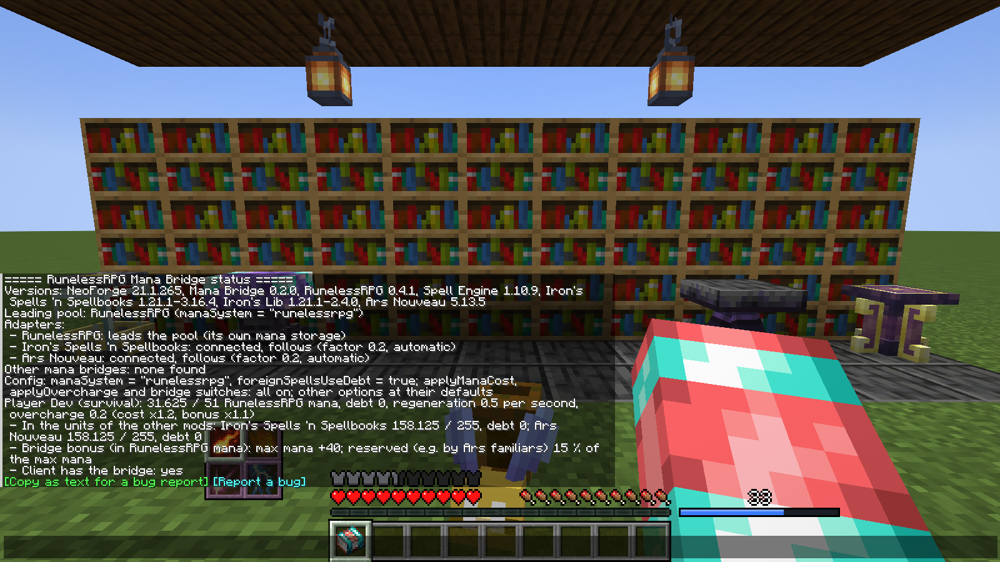 |
| 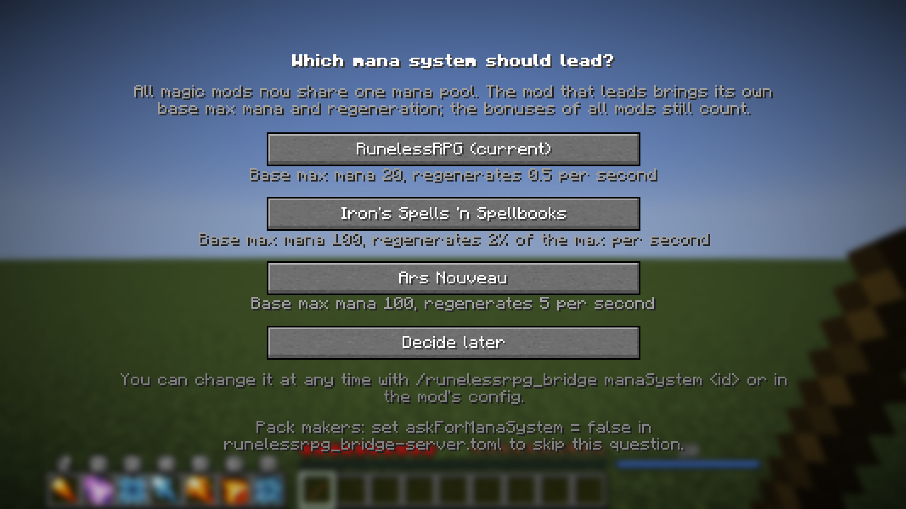 | 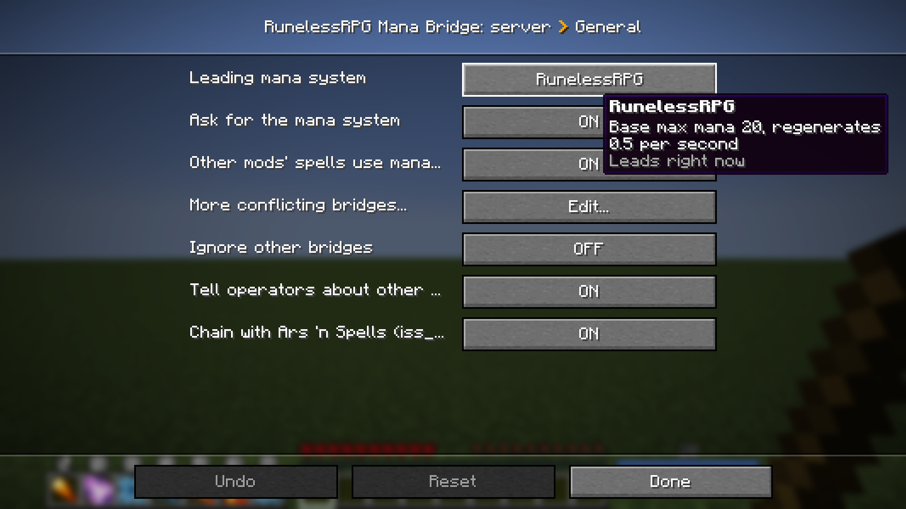 |
| 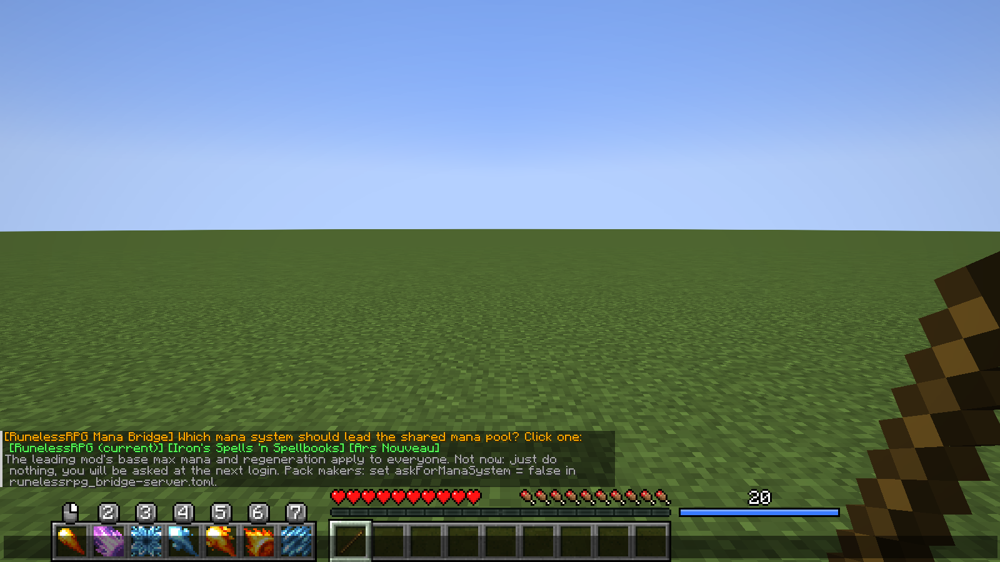 | 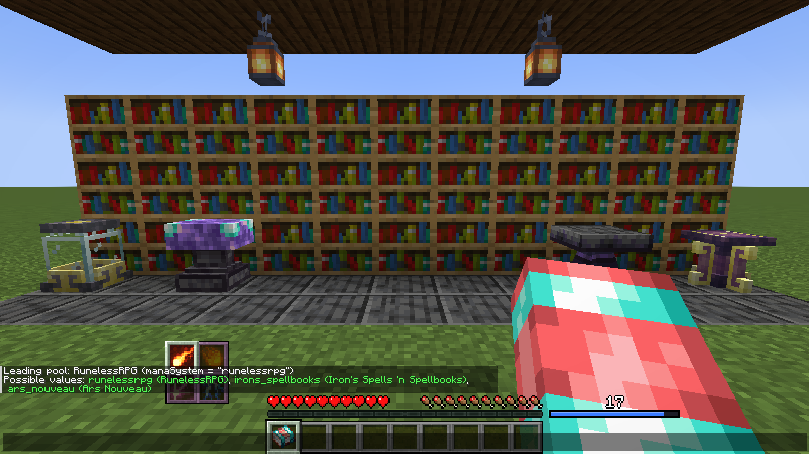 |
| 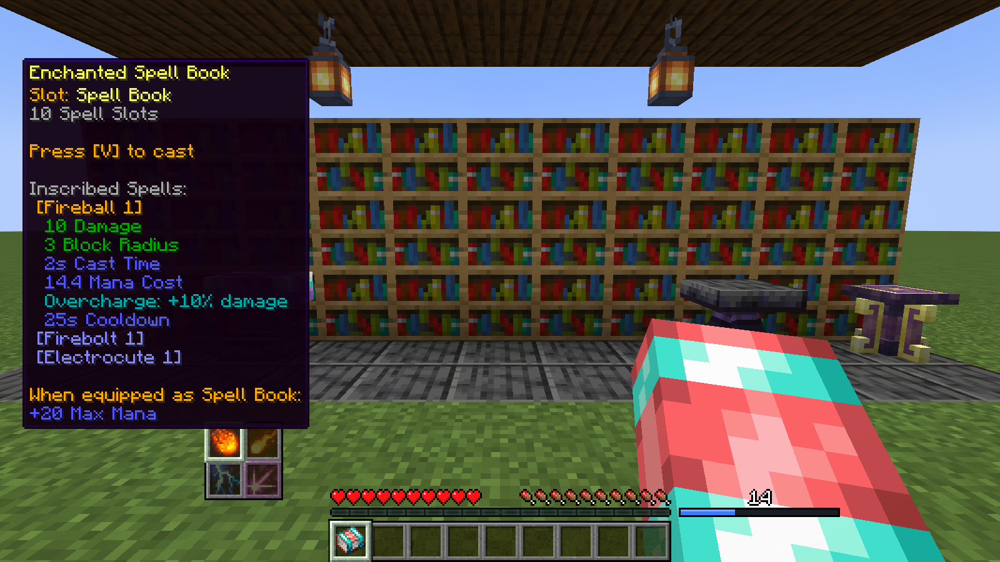 | 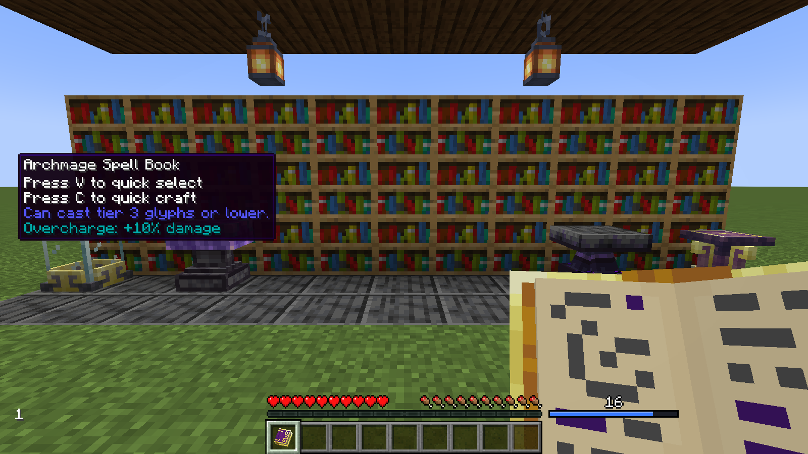 |
| 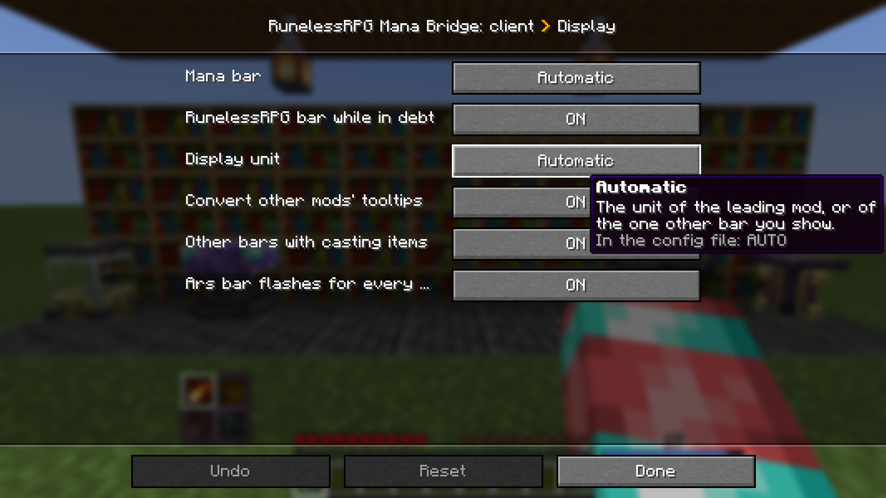 | |

## How it works

RunelessRPG (0.4.0 and newer) has an API for other mana systems: a replaceable mana storage, a debt account and helpers to pay for spells of other mods; 0.4.1 added overcharge for spells of other mods. The bridge sits on top of it. Inside, everything is counted in RunelessRPG mana; every other mod has a **factor** (1 Iron's mana and 1 Ars mana = 0.2 RunelessRPG mana by default: RunelessRPG's base max mana of 20 divided by the other mod's base max mana of 100).

- **The leading mod** (`manaSystem`) holds the number. It keeps its own base mana, regeneration and its rules for respawn and death. By default RunelessRPG leads; with `manaSystem = "irons_spellbooks"` Iron's own mana becomes the pool, with `"ars_nouveau"` Ars' own mana.
- **The other mods follow**: a small set of mixins (only `@Inject`, `@WrapOperation` and `@ModifyReturnValue`) makes them read and write the shared pool in their own units, turns off their own regeneration and lets their spells pay through RunelessRPG with the same cost, debt and overcharge rules as Spell Engine spells.
- **Bonuses cross over**: max mana and regeneration bonuses of the following mods (gear, and for Ars also learned glyphs and the spell book tier) are read every tick, converted and added to the leading mod as modifiers of the same operation.
- **A self test** checks at startup that every mixin found its target. If Iron's or Ars changes in an update, only that adapter turns off with one warning, and the mod works as without the bridge.

Changing the mode only changes the regeneration: the same gear and the same spells give the same share of the pool in all three modes.

## Installation

1. Install NeoForge `21.1` for Minecraft `1.21.1`.
2. Install [RunelessRPG](https://www.curseforge.com/minecraft/mc-mods/runelessrpg) `0.4.1` or newer with [Spell Engine](https://www.curseforge.com/minecraft/mc-mods/spell-engine).
3. Install [Iron's Spells 'n Spellbooks](https://www.curseforge.com/minecraft/mc-mods/irons-spells-n-spellbooks), [Ars Nouveau](https://www.curseforge.com/minecraft/mc-mods/ars-nouveau) or both, with their own dependencies.
4. Put `runelessrpg_bridge-0.2.0.jar` into the `mods` folder of the **server and of every client**.
5. At the first login the bridge asks which mana system should lead (in singleplayer, or an operator on a server). Packs that ship their config set `askForManaSystem = false`.

| Mod | Tested version | Needed |
|---|---|---|
| RunelessRPG | `0.4.1` | **required** (`0.4.1` or newer) |
| Spell Engine, Spell Power | `1.10.9`, `1.6.0` | required by RunelessRPG |
| Iron's Spells 'n Spellbooks | `1.21.1-3.16.4` | optional (`1.21.1-3.16.4` or newer) |
| Iron's Lib | `1.21.1-2.4.0` | required by Iron's Spells 'n Spellbooks |
| Ars Nouveau | `5.13.5` | optional (`5.13.5` or newer) |
| Curios API, GeckoLib | `9.5.1`, `4.9.2` | required by Iron's and Ars, not by the bridge |

Without Iron's and Ars the bridge writes one line to the log and does nothing else.

## What it does

### One pool for all mods
Iron's spells, Iron's Mana potion, Gluttony and the `/mana` command, Ars spells (every form, also from bows and crossbows), the Ring of Jumping, the Repairing perk, the Void Jar and Ars addons that add or remove mana use the shared pool. With the default factor an Iron's Fireball (60 Iron's mana) costs 12 RunelessRPG mana and an Ars projectile with Harm (25 Ars mana) costs 5. Iron's mobs, Ars turrets and runes, familiars and fake players keep their own mana. More: [Wiki → How it works](https://github.com/Drehverschluss/RunelessRPG-Mana-Bridge/wiki/How-It-Works).

### Three modes
| `manaSystem` | Base max mana | Regeneration | After a respawn |
|---|---|---|---|
| `"runelessrpg"` (default) | RunelessRPG: 20 | RunelessRPG: 0.5 per second plus bonuses | full (RunelessRPG) |
| `"irons_spellbooks"` | Iron's: 100 | Iron's: 2 % of max mana per second plus bonuses | Iron's `manaSpawnPercent` (default 0 = empty) |
| `"ars_nouveau"` | Ars: 100 plus learned glyphs and spell book tier | Ars: 5 per second plus glyphs, tier and bonuses | Ars' own rule: the mana of the moment of death stays |

Packs where Iron's or Ars is the main magic, or with many addons of that mod, should let it lead. More: [Wiki → Modes](https://github.com/Drehverschluss/RunelessRPG-Mana-Bridge/wiki/Modes).

### Choosing the mana system (since 0.2.0)
- **The question at the first start**: while Iron's or Ars is connected, the owner of a singleplayer world (or the LAN host) or an operator on a server is asked once at login which mana system should lead. Every button shows the base max mana and regeneration it brings, read from the real configs. Every answer turns `askForManaSystem` off; "Decide later" asks again at the next login. A client without the bridge gets a chat line with clickable values.
- **The command** `/runelessrpg_bridge manaSystem [<id>]`: without an ID it shows the leading pool and the possible values (every player), with an ID it sets and saves `manaSystem` (operators, the console and the owner of a singleplayer or LAN world).
- **The config screen**: `manaSystem`, `manaDisplay` and `displayUnit` are buttons with readable names and a tooltip for every value; the file keeps the mod IDs. NeoForge lets the screen edit the server config only in a singleplayer world that is not open to LAN; elsewhere the command helps.
- Every way switches the pool at once, without a restart and without losing mana or debt. The server config counts for every world of an installation or server, unless a world has its own `serverconfig/runelessrpg_bridge-server.toml`.

### Gear of all mods counts
Iron's robes, rings, spell books in the spellbook slot and mana upgrade orbs, Ars' Mana Boost and Mana Regen enchantments, armor tiers, curios and the Mana Regeneration potion raise the shared pool while their mod follows (a robe with +125 Iron's max mana gives +25 RunelessRPG max mana, Mana Boost III with +75 Ars max mana gives +15). While Iron's or Ars leads, RunelessRPG's enchantments, affixes and gear raise its mana (+25 RunelessRPG max mana gives +125). Flat values are converted, percent values stay percent.

### Ars Nouveau
- **Ars follows** (RunelessRPG or Iron's leads): Ars reads and writes the shared pool, its own regeneration is off. Ars spell costs come after Ars' own discounts and cost events, then `runelessrpg:mana_cost` applies. **Ars progress counts too**: learned glyphs and the spell book tier raise the shared max mana and regeneration (`bridgeProgression`; 50 glyphs and tier 3 give +180 max mana and +3.9 per second), otherwise an Ars player would have about a tenth of the mana Ars itself gives. **Familiars** reserve their share of the shared max mana (15 % for the first familiar, `applyFamiliarReserve`).
- **Ars leads** (`manaSystem = "ars_nouveau"`): Ars works as without this mod, with its own regeneration, progress, gear, familiars and rules for respawn and death. Spell Engine spells cost five times their RunelessRPG cost in Ars mana (an RPG Series Fireball costs 20), Iron's spells pay 1 : 1.
- Ars' bar can be the chosen bar, it shows the shared pool, flashes red for every failed cast of any mod and also shows while you hold a Spell Engine or Iron's casting item. More: [Wiki → Ars Nouveau](https://github.com/Drehverschluss/RunelessRPG-Mana-Bridge/wiki/Ars-Nouveau).

### Costs and debt
Iron's and Ars spell costs follow `runelessrpg:mana_cost` (with its lower limit and Spell Infinity), and they use the same debt rules as Spell Engine spells (RunelessRPG's DEBT modes, Borrowed Power), in every mode. Iron's and Ars bars cannot show debt, so RunelessRPG's bar appears with the minus while you are in debt. More: [Wiki → Iron's Spells](https://github.com/Drehverschluss/RunelessRPG-Mana-Bridge/wiki/Irons-Spells).

### Overcharge for Iron's and Ars spells (since 0.2.0)
`runelessrpg:overcharge` works on Iron's and Ars spells with the same rules as on Spell Engine spells: the cost goes up after the lower limit of Mana Cost (an Iron's Fireball costs 14.4 instead of 12 RunelessRPG mana at overcharge 0.2, an Ars projectile with Harm 6 instead of 5), and damage and healing go up by overcharge × RunelessRPG's `overchargeDamageFactor` (× 1.1). Summons, zones and runes keep the bonus they were made with, Iron's projectiles the bonus of the cast that fired them, also after the chunk is saved and loaded. Only spells the player pays through the bridge get it: no scrolls, Ars turrets, runes from Runic Chalk or spells that Ars 'n Spells pays; damage over time and effects stay as they are. Iron's spell tooltips and Ars casting items show "Overcharge: +10% damage", and every converted cost includes the surcharge. Switch: `applyOvercharge` per adapter. More: [Wiki → Overcharge](https://github.com/Drehverschluss/RunelessRPG-Mana-Bridge/wiki/Overcharge).

### Mana bar and units
Every player picks the bar (`manaDisplay`: the leading mod's, RunelessRPG's, Iron's, Ars' or all) and the unit of all numbers (`displayUnit`). Iron's spell tooltips, the spell wheel, the Inscription Table, max mana and regeneration values on Iron's and Ars gear, Ars' Rings of Discount and the cost bar in Ars' spell book are converted into that unit, RunelessRPG's own numbers too. Iron's and Ars bars in their "contextual" mode also show while you hold a casting item of another mod. More: [Wiki → Display](https://github.com/Drehverschluss/RunelessRPG-Mana-Bridge/wiki/Display).

### Spell Mana Leech for Iron's and Ars spells
`runelessrpg:spell_mana_leech` also works on direct hits of Iron's spells (instant, channeled, projectile and cone spells) and of Ars spells (projectile, touch, self, underfoot, burst, delay), with all of RunelessRPG's rules and one shared counter for all mods. Zones (Iron's zones, Ars' Linger, Wall and Orbit), runes, turrets, summons and damage over time do not count. More: [Wiki → Spell Mana Leech](https://github.com/Drehverschluss/RunelessRPG-Mana-Bridge/wiki/Spell-Mana-Leech).

### Ars 'n Spells and other mana bridges
[Ars 'n Spells](https://www.curseforge.com/minecraft/mc-mods/ars-n-spells) connects Iron's and Ars itself. The bridge works with it in a **chain** (`chainWithArsNSpells`): in its mode `iss_primary` only the Iron's adapter runs, in `ars_primary` only the Ars adapter, and Ars 'n Spells keeps Ars ↔ Iron's. Ars 'n Spells pays some spells itself, and these skip Mana Cost, the debt rules and overcharge of the bridge: Ars spells in every mode of its mana unification (also on `separate`), Iron's spells on `ars_primary`. Spells of the mod whose adapter is off give no Spell Mana Leech. For every function of the bridge with Iron's and Ars spells, set `enable_mana_unification = false` in Ars 'n Spells' server config; it keeps its other functions. Since 0.2.0 Iron's own regeneration no longer flows into the pool on `ars_primary`, and Ars 'n Spells no longer cancels Iron's casts there. Ars Mana Bridge, Mana Transform, Mana Unifier and Unified Mana are detected: while one of them connects a mod's mana itself, that adapter turns off with a warning in the log and a chat message for operators, so two bridges never pull at the same pool. More: [Wiki → Other mana bridges](https://github.com/Drehverschluss/RunelessRPG-Mana-Bridge/wiki/Other-Mana-Bridges).

### Status command
`/runelessrpg_bridge status` shows versions, the leading pool, the state of every adapter, other bridges, the config and your own mana and overcharge. A click at the end copies everything as English text for a bug report. Every player can use it for themselves; operators and the console can add a player name. More: [Wiki → Commands and bug reports](https://github.com/Drehverschluss/RunelessRPG-Mana-Bridge/wiki/Commands-and-Bug-Reports).

## Configuration

`config/runelessrpg_bridge-server.toml` (server, sent to the clients where needed):

| Option | Default | Effect |
|---|---|---|
| `general.manaSystem` | `"runelessrpg"` | Which mod leads the pool: `"runelessrpg"`, `"irons_spellbooks"` or `"ars_nouveau"`; also with `/runelessrpg_bridge manaSystem <id>` |
| `general.askForManaSystem` | `true` | Ask once at login which mana system should lead (singleplayer owner or operator); packs that ship their config set it to `false` |
| `general.foreignSpellsUseDebt` | `true` | Iron's and Ars spells may go into debt like Spell Engine spells |
| `general.chainWithArsNSpells` | `true` | Chain with Ars 'n Spells in its modes `iss_primary` and `ars_primary` |
| `irons_spellbooks.manaFactor`, `ars_nouveau.manaFactor` | `-1.0` | 1 mana of that mod = this much RunelessRPG mana; −1 = automatic (0.2) |
| `irons_spellbooks.applyManaCost`, `ars_nouveau.applyManaCost` | `true` | `runelessrpg:mana_cost` applies to that mod's spells |
| `irons_spellbooks.applyOvercharge`, `ars_nouveau.applyOvercharge` | `true` | `runelessrpg:overcharge` applies to that mod's spells (cost and bonus) |
| `bridgeMaxMana`, `bridgeManaRegen`, `bridgePercentBonuses` (in `[runelessrpg]`, `[irons_spellbooks]`, `[ars_nouveau]`) | `true` | Which bonuses of that mod's gear count while it does not lead |
| `ars_nouveau.bridgeProgression`, `ars_nouveau.applyFamiliarReserve` | `true` | Ars progress counts and familiars reserve their share while Ars does not lead |

`config/runelessrpg_bridge-client.toml` (every player): `manaDisplay` (`"auto"`), `displayUnit` (`AUTO`), `showRunelessBarOnDebt`, `convertForeignTooltips`, `showForeignBarWithSpellWeapons` and `forwardInsufficientFlash` (all `true`). Every option works at runtime. All options with their effect: [Wiki → Configuration](https://github.com/Drehverschluss/RunelessRPG-Mana-Bridge/wiki/Configuration).

## Data-driven customization

Which hits of Iron's spells count for Spell Mana Leech can be changed with two entity tags:

| Tag | Default entries | Effect |
|---|---|---|
| `runelessrpg_bridge:spell_leech/direct` | lightning bolt, evoker fangs, firework rocket, Devour jaw, Sunbeam, Ice Spike, Poison Splash | Hits by these entities always count |
| `runelessrpg_bridge:spell_leech/excluded` | Echoing Strikes (sword and arrow), Ball Lightning | Hits by these entities never count (wins over `direct`) |

Add entries with a datapack (`data/runelessrpg_bridge/tags/entity_type/spell_leech/direct.json`). For Ars spells the option `ars_nouveau.leechZoneGlyphs` lists the glyphs after which damage counts as a lasting zone (default Linger, Wall and Orbit). RunelessRPG's `#runelessrpg:no_mana_leech` still applies to the targets. Example: [Wiki → Spell Mana Leech](https://github.com/Drehverschluss/RunelessRPG-Mana-Bridge/wiki/Spell-Mana-Leech).

## Mod compatibility

| Mod | What happens |
|---|---|
| Iron's Spells 'n Spellbooks | connected (follows or leads) |
| Ars Nouveau | connected (follows or leads) |
| Iron's addons | Their spells and their mana access through Iron's `MagicData` use the shared pool; not tested one by one, see [Wiki → Modes](https://github.com/Drehverschluss/RunelessRPG-Mana-Bridge/wiki/Modes) |
| Ars addons | Their spells, their mana access through Ars' mana capability and their changes to Ars' max mana and regeneration count; not tested one by one (Ars Elemental 0.7.6.6 only for start, spells, max mana and regeneration) |
| Ars 'n Spells | chain in `iss_primary` and `ars_primary` (one adapter runs), both adapters run in `separate` (Ars 'n Spells still pays Ars spells there), both are off in `hybrid`; every function with `enable_mana_unification = false` |
| Ars Mana Bridge, Mana Transform, Mana Unifier, Unified Mana | detected; the affected adapter turns off while they connect that mod's mana |
| Miki's Fantasy HUD | RunelessRPG's bar docks there as before; where Iron's and Ars bars sit is set in their own client configs |
| Gearscope | shows max mana values of Iron's gear in the display unit; Ars values take the same way (not tested with Gearscope) |

## Project layout

| Package | Content |
|---|---|
| `com.drehverschluss.runelessrpg_bridge` | `ManaBridge` (common entry point) and `ManaBridgeClient` (client entry point) |
| `api` | `ManaAdapter` (one adapter per mana mod, experimental), `AdapterStatus`, `BridgeBonus`, `ConflictCheck`, `LeadInfo` |
| `core` | Leading pool, the switch in other mods' units (`Pool`), bonus bridge, overcharge for spells of other mods, configs, the choice of the mana system (command and question), self test, detection of other bridges, status command; no class of another mod |
| `core.network`, `core.client` | Optional payloads to the clients (settings, overcharge, the question); bar choice, display unit, config screen buttons, the question window |
| `adapter.runelessrpg` | RunelessRPG as an adapter (its storage, its bonuses) |
| `adapter.irons_spellbooks` | Iron's adapter: description, hooks, storage while Iron's leads, cost listener, leech rule, mixins (own mixin config, only loaded with Iron's) |
| `adapter.ars_nouveau` | Ars adapter: description, hooks, events, storage while Ars leads, leech rule, mixins (own mixin config, only loaded with Ars) |

## Development

Requires Java 21. Every mod is compiled against from a Maven (RunelessRPG from CurseMaven, Spell Engine, Spell Power, Iron's, Iron's Lib and Ars Nouveau from the Modrinth Maven), so no local jars are needed to build.

```
./gradlew build        # jar in build/libs
./gradlew runClient    # dev client (game directory run/)
./gradlew runServer    # dev dedicated server (accept the EULA on first start)
```

### Testing

The dev runs load test mods from `libs/test/` (git-ignored) in groups. The Gradle property `test_mods` picks them: `none` (only RunelessRPG with Spell Engine and the RPG Series), `irons`, `ars` or `irons,ars` (default), for example `./gradlew runServer -Ptest_mods=none`. Every change is tested in all four groups.

For every version I run an automated test: a dedicated server plays a script tick by tick (casting spells of all three mods, every form of Iron's and Ars spells with overcharge, changing configs at runtime, switching between all three modes, debt, gear and Ars progress, familiars, relog, respawn, other bridges and chains, two clients, clients and servers without the bridge), and the client takes pictures, reads tooltips and clicks through the config screen and the question on request. The test code is removed before the release.

## License and credits

MIT, see [LICENSE](LICENSE). Credits and licenses of everything the bridge uses or refers to are in [CREDITS.md](CREDITS.md).

- RunelessRPG Mana Bridge is not made by or affiliated with the authors of Iron's Spells 'n Spellbooks, Ars Nouveau or Spell Engine.
- 📖 [Wiki](https://github.com/Drehverschluss/RunelessRPG-Mana-Bridge/wiki) · 🐞 [Issues](https://github.com/Drehverschluss/RunelessRPG-Mana-Bridge/issues) · 🔮 [CurseForge](https://www.curseforge.com/minecraft/mc-mods/runelessrpg-mana-bridge)
